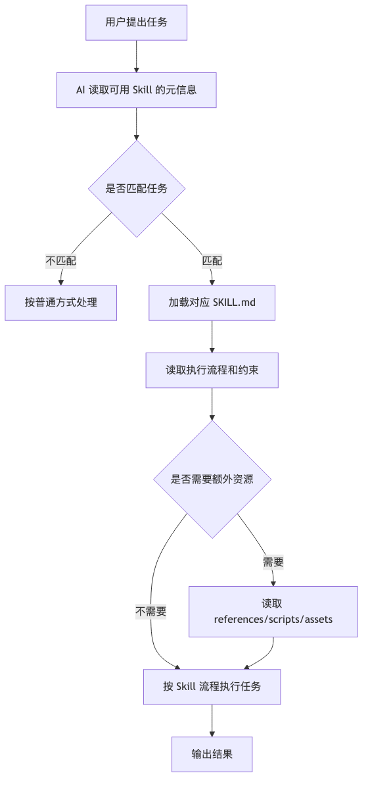

## 先说结论

`Skill` 可以先理解成 AI 的“专业能力模块”。

它不是一段临时 prompt，也不是一个外部工具。更准确地说，Skill 是把一类任务里的经验、规则、操作流程和参考资料，封装成一份可复用的说明书。

比如：

- 写周报时，加载“周报整理 Skill”。
- 审阅合同时，加载“合同审阅 Skill”。
- 清洗数据时，加载“数据清洗 Skill”。
- 整理会议录音时，加载“会议纪要 Skill”。

好的 Skill 不能把弱模型变成强模型，但能减少模型在具体任务里的摇摆。

这里的“强模型”和“弱模型”不是永久标签，而是相对任务复杂度来说的。

强模型通常指各家公司旗舰级、推理型或专业工作模型。比如 GPT、Claude、Gemini、DeepSeek、Qwen 这些模型家族里的高端版本，通常更适合处理长上下文、多步骤推理、复杂代码、严肃分析和 Agent 工作流。

弱模型不是贬义，更多是指能力、上下文、推理深度或稳定性更有限的模型。比如旧一代模型、小参数本地模型、量化后的 7B/8B/14B 模型，或者各家为了低成本和低延迟设计的 `mini`、`lite`、`flash-lite` 类模型。它们很适合分类、改写、简单摘要、格式转换这类边界清楚的任务。但遇到复杂规划、长文档推理或多工具协作时，更容易漏步骤、误解约束，或者前后说法不一致。

Skill 的作用，是把任务流程、质量标准和反例提前写清楚。强模型用了 Skill，输出会更稳；弱模型用了 Skill，也能少犯一些低级错误。但如果任务本身需要很强的推理、长上下文或专业判断，Skill 不能替代模型能力。

## 为什么需要 Skill？

很多人刚开始用 AI，习惯把所有要求都塞进一段长 prompt：

```text
你是一个资深编辑，请帮我写文章。
要求语言自然，结构清晰，不要 AI 味，适合对外发布。
标题要吸引人，内容要有案例，还要有结论。
```

这类 prompt 当然能用，但问题也明显：

- 每次都要重新写。
- 规则散落在聊天记录里，不好维护。
- 复杂任务会越写越长，最后重点被淹没。
- 同类任务之间无法沉淀经验。
- 换一个 AI 工具后，又要重新组织一遍。

Skill 解决的就是“经验复用”的问题。

它把那些稳定、反复出现、值得沉淀的做法写成文件。AI 在需要时读取这个文件，再按里面的流程执行任务。

你可以把 Skill 理解成三件东西的结合：

- AI 的专业知识模块。
- AI 的长期记忆和行为约束。
- 某个任务或技术栈的官方用法说明书。

## Skill 如何触发？

Skill 的触发通常有两种方式：用户显式触发，以及系统自动触发。

### 用户显式触发

最直接的方式，是你在请求里点名某个 Skill。

```text
使用 weekly-report skill，帮我把这些工作记录整理成本周周报。
```

这种方式最稳定，因为你已经明确告诉 AI：这次任务应该使用哪个能力模块。

### 系统自动触发

更常见的方式，是 AI 根据 Skill 的元信息判断是否需要加载。

每个 `SKILL.md` 文件开头一般都有一段 YAML FrontMatter：

```yaml
---
name: weekly-report
description: "整理和生成工作周报。适用于周报、本周总结、weekly report、项目进展汇总。当用户要求整理一周工作、生成周报或总结项目进展时使用。"
---
```

其中最关键的是：

- `name`：Skill 的名称。
- `description`：说明这个 Skill 能干什么、什么时候应该使用。

当用户说“帮我写周报”“整理本周工作”“把这些记录变成本周总结”时，AI 会根据 description 判断：这可能匹配 `weekly-report`，于是读取对应的 `SKILL.md`。

所以，Skill 能不能被准确触发，很大程度取决于 `description` 写得清不清楚。

## Skill 如何工作？

Skill 的工作方式，可以概括成一句话：

AI 先看 Skill 的元信息，判断是否相关；相关时再读取正文和必要资源，把这些内容临时加入当前任务上下文。

一个简化流程如下：



这里有一个关键点：Skill 应该渐进式加载。

也就是说，AI 不应该一上来把 Skill 目录里的所有内容都读完。更合理的做法是：

1. 先看 Skill 的头部元信息，判断是否该用。
2. 再读 `SKILL.md` 的总流程。
3. 如果流程需要，再读取具体的参考资料、模板、脚本或资产。

这样能减少上下文浪费。AI 的上下文窗口不是无限的。如果一个 Skill 把规则、案例、模板、FAQ 全塞进一个大文件，模型每次都要加载一大坨内容，任务重点反而会被淹没。

## 一个 Skill 通常长什么样？

一个基础 Skill 可以只有一个文件：

```text
weekly-report/
└── SKILL.md
```

复杂一点的 Skill，可以带上辅助资源：

```text
weekly-report/
├── SKILL.md
├── references/
│   └── report-style.md
├── scripts/
│   └── summarize_tasks.py
└── assets/
    └── weekly-template.md
```

其中 `SKILL.md` 是核心。

它一般由两部分组成：

- FrontMatter：告诉 AI 这个 Skill 叫什么、什么时候使用。
- Markdown 正文：告诉 AI 触发后具体怎么做。

正文至少要回答几个问题：

- 这个 Skill 的目标是什么？
- 执行步骤是什么？
- 输出格式是什么？
- 有哪些质量标准？
- 遇到模糊需求时应该怎么问？
- 有哪些常见错误要避免？

## Skill、System Prompt 和 MCP 的区别

这三者经常被混在一起，但分工完全不同。

| 名称 | 解决什么问题 | 什么时候加载 | 典型内容 |
|---|---|---|---|
| System Prompt | 全局行为规则 | 每轮对话都加载 | 身份、语气、安全边界、通用约束 |
| Skill | 某类任务的知识和流程 | 命中任务时加载 | 执行步骤、质量标准、模板、示例 |
| MCP | 外部能力接口 | 需要调用工具时使用 | 数据库、浏览器、文件系统、第三方 API |

一句话区分：

- System Prompt 告诉 AI “你始终应该怎么做”。
- Skill 告诉 AI “遇到这类任务时应该怎么做”。
- MCP 告诉 AI “你可以调用哪些外部能力去做”。

比如用户说：

```text
帮我把这篇文章做成一份 PPT。
```

可能发生的是：

1. System Prompt 约束 AI 的总体行为，比如要直接、准确、不要编造。
2. PowerPoint Skill 告诉 AI 如何设计页面结构、版式、图表和演示节奏。
3. 文件系统或文档工具作为 MCP/工具接口，让 AI 真正创建 `.pptx` 文件。

三者不是替代关系，而是搭配关系。

## 什么样的 Skill 才算好？

我会用五个标准判断一个 Skill 好不好。

### 1. 触发准确

用户提出相关任务时，它能被加载；用户提出无关任务时，它不会乱入。

这主要靠 `name` 和 `description`。

### 2. 边界清楚

它应该说清楚适合什么任务、不适合什么任务，以及和相邻 Skill 的区别是什么。

### 3. 流程可执行

正文不能只有“专业、自然、高质量”这类价值观。AI 读完以后，应该知道先做什么、后做什么，遇到缺信息时怎么处理，最后输出什么格式。

### 4. 内容可渐进加载

不要把所有材料塞进一个超长 `SKILL.md`。核心流程放正文，长资料拆成 `references/`，固定素材放进 `assets/`，稳定脚本放进 `scripts/`。

### 5. 能持续迭代

Skill 不是一次性写完的。每次你发现 AI 输出不稳定，都可以回到 Skill 里补一条规则、一个反例、一个模板，或者一个脚本。

## 什么时候应该使用 Skill？

如果一个任务只做一次，不一定要写 Skill。

但如果你发现自己反复对 AI 说同样的话，就可以考虑沉淀成 Skill。

典型信号包括：

- 你经常复制同一段 prompt。
- 你经常纠正 AI 的同一种错误。
- 你希望某类输出保持固定格式。
- 你有一套自己的审美、流程或判断标准。
- 你希望换工具后仍能复用这套经验。

比如写文章这件事，如果你每次都要提醒它：

```text
不要写得太像 AI。
开头别废话。
先给结论。
每段短一点。
保留关键判断。
不要乱用形容词。
```

那就可以做一个写作 Skill。

## 小结

Skill 的本质不是“更长的提示词”，而是“可复用的任务工作流”。

它把经验从聊天窗口里抽出来，变成可以命名、触发、维护和组合的文件。这样 AI 在处理重复任务时，不需要每次从零理解你的偏好，也不用临场猜什么叫“专业”。

真正有价值的 Skill，通常不是写得最长的那个，而是边界最清楚、触发最准确、流程最可执行的那个。

