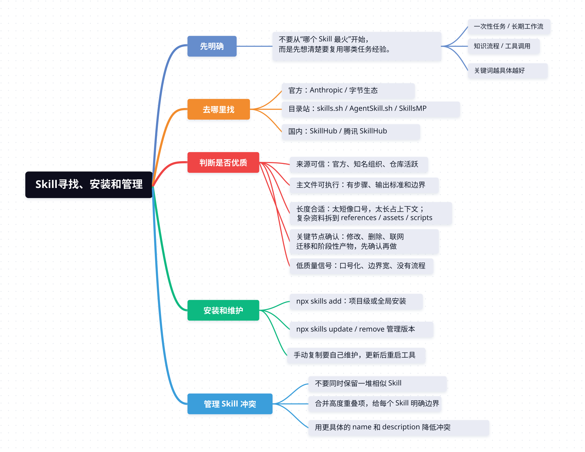

> 这是 Skill 系列的第二篇。上一篇[AI Skill 是什么？一篇讲清楚它和 Prompt、MCP 的区别](https://mp.weixin.qq.com/s/Aj7mOtgJd2xxlNJg464wow)讲了 Skill 是什么，这一篇讲怎么找到靠谱 Skill、怎么安装，以及为什么不要盲目安装一堆相似 Skill。

## 先说结论

找 Skill 不要从“哪个 Skill 最火”开始，而要从“我想稳定复用哪类任务经验”开始。

优质 Skill 的判断标准很简单：

- 来源可信。
- 触发边界清楚。
- `SKILL.md` 有可执行流程。
- 资源目录拆分合理。
- 不和已有 Skill 大面积重叠。

安装方式主要有三种：

- 用 `npx skills` 搜索和安装。
- 从 GitHub 仓库安装。
- 手动复制 Skill 目录到全局目录。

## 先明确你要解决什么问题

不要一上来就搜“best skills”。

先把自己的需求说清楚：

- 是写作问题，还是代码问题？
- 是前端开发，还是测试、部署、文档？
- 是一次性任务，还是经常重复的工作流？
- 是需要知识和流程，还是需要工具调用能力？

比如你想提升 React 项目的质量，搜索关键词就不应该只是：

```text
react
```

而应该更具体：

```text
react performance
react testing
nextjs best practices
frontend accessibility
```

关键词越具体，越容易找到边界清楚的 Skill。

## 去哪里找 Skill？

直接去这些地方找就行。

| 网址 | Skill 数量 | 适合找什么 | 优势 | 注意点 |
|---|:---:|---|---|---|
| `https://github.com/anthropics/skills` | 10+ | Anthropic 官方 Skills 目录 | 官方仓库，能直接看 Skill 文件结构 | 适合学习和参考，不一定每个都适合直接装 |
| `https://skills.sh/` | 389K+ | 开放生态里的公开 Skill | 入口集中，适合先扫一遍 | 热度不等于质量，最后还是要看原仓库 |
| `https://skills.sh/official` | —— | 各厂商官方 Skill | 官方维护，兼容性通常最好 | 数量有限，覆盖面没那么全 |
| `https://agentskill.sh/` | 135K+ | AgentSkill.sh 目录 | 搜索和安装一体，覆盖面大 | 聚合站属性强，仍要回到原仓库复核 |
| `https://skillsmp.com/` | 100K+ | SkillsMP 市场 | 分类清楚，适合按用途找 | 量大，筛选时要更看重来源和质量分 |
| `https://skills-hub.ai/` | 4K+ | 通用 SkillHub 目录 | 适合快速浏览公开技能 | 需要自己判断是否和当前工具兼容 |
| `https://skillhub.cn/` | 10K+ | 腾讯 SkillHub | 国内访问更方便，中文场景友好 | 页面口径是平台展示口径，安装前仍要看具体 Skill |
| `https://github.com/bytedance/deer-flow` | 20+ | 字节生态里的 Skill 示例和内置技能 | 能直接看项目里怎么组织 Skill | 更偏项目生态，不是通用目录 |

找 Skill 时，先看这些网址里的原仓库，再回头看 `SKILL.md`，比只看名字靠谱得多。

## 如何判断 Skill 是否优质？

Skill 会影响 AI 的行为，所以来源很重要。

### 先看来源是否可信

优先考虑：

- 官方或知名组织维护的 Skill。
- 大厂工程团队公开的 Skill。
- GitHub 仓库活跃、star 较多、issue 有维护的 Skill。
- 安装量高、被多人验证过的 Skill。

需要谨慎对待：

- 作者不明的 Skill。
- `description` 写得很夸张，但内容很空的 Skill。
- 只有几行 prompt、没有明确流程的 Skill。
- 要求读取过多敏感文件或使用不必要工具的 Skill。

安装前最好打开 `SKILL.md` 看一眼，尤其关注三件事：

1. 它什么时候触发？
2. 它具体要求 AI 怎么做？
3. 它会不会和你已有的 Skill 冲突？

### 再看主文件是否可执行

一个优质 Skill 通常有这些特征：

- `description` 清楚，触发边界明确。
- 正文有可执行步骤，不只是口号。
- 有输出格式、质量标准和反例。
- 复杂任务会拆分 `references/`、`scripts/`、`assets/`。
- 关键节点会要求用户确认。
- 不会要求 AI 做和任务无关的事。
- 不会把所有场景都塞进一个 Skill。

### 看内容长度是否合适

这里还要看一个很实际的问题：整个 `SKILL.md` 写多少字合适？

好的 Skill 通常不是越长越好。

如果只是单一流程型 Skill，比如周报、代码评审、PRD 大纲、技术博客写作，`SKILL.md` 控制在 500 到 1500 个中文字符左右通常比较合适。

如果是复杂工作流型 Skill，比如 PPT 生成、Excel 分析、图片生成、浏览器自动化、项目迁移，`SKILL.md` 可以写到 1500 到 3000 个中文字符左右。但详细规范、模板、脚本最好放到 `references/`、`assets/`、`scripts/` 里，不要全部塞进主文件。

如果一个 Skill 少于 300 个中文字符，通常要警惕它是不是只写了几句口号：

```text
你是一个专业的写作助手。请认真、自然、清晰地完成用户任务。
```

这种 Skill 很难带来稳定提升，因为它没有告诉 AI 具体流程、判断标准和输出要求。

如果一个 Skill 超过 4000 个中文字符，也要警惕两个问题。

第一，它可能把太多场景塞在一起，导致触发边界变模糊，AI 每次都要在一堆规则里找重点。

第二，它会占用 AI 的上下文空间。Skill 被加载后，里面的说明会进入模型可参考的上下文。主文件越长，留给用户需求、项目代码、报错信息和对话历史的空间就越少。上下文被无关规则挤占之后，AI 反而更容易遗漏真正重要的信息。

更好的做法是：

- 主 `SKILL.md` 写清楚触发场景、执行步骤、输出格式和质量标准。
- 长模板放到 `assets/`。
- 详细参考资料放到 `references/`。
- 可执行脚本放到 `scripts/`。
- 多个差异很大的场景拆成多个 Skill。

简单说，主文件应该像一份清晰的操作手册，而不是一篇长论文。

### 看关键节点是否会确认

一个优质 Skill 还应该知道什么时候停下来问用户。

Skill 的目的不是让 AI 一路自动做到底，而是把重复流程标准化。遇到关键节点时，好的 Skill 会明确要求 AI 先给出方案、差异或风险，再等用户确认。

常见需要用户确认的节点包括：

- 开始执行前：确认目标、输入材料和成功标准。
- 多方案选择时：让用户在几个方向里选一个。
- 写作或设计类任务：先确认大纲、风格、结构，再进入完整生成。
- 代码修改类任务：先说明修改范围和影响，再动手改文件。
- 涉及删除、覆盖、迁移、批量修改时：必须先确认。
- 涉及联网、上传、下载、调用外部服务时：先说明原因和风险。
- 生成阶段性产物后：让用户确认是否继续下一步。

比如，一个好的 PPT 生成 Skill 不应该一上来就生成整套幻灯片，而是先确认受众、汇报目标、页数、结构和视觉风格。

一个好的代码迁移 Skill 也不应该直接批量改文件，而是先列出迁移范围、风险点和验证方式。

如果一个 Skill 明确要求 AI 在这些节点停下来，就说明它不是只追求“自动化”，而是在控制风险。

### 看有没有低质量信号

一个低质量 Skill 常见的问题是：

- 名字很大，比如 `super-productivity-ai`，但内容只有几条泛泛建议。
- `description` 太宽，比如“帮助你完成所有工作”。
- 流程不可执行，比如“要认真、专业、有创造力”。
- 和其他 Skill 高度重叠，容易造成冲突。
- 没有说明什么时候不该使用。

判断 Skill 好不好，不是看它写得多长，而是看它能不能让 AI 在一个具体任务上更稳定。

## 安装前要检查什么？

Skill 虽然通常只是文本和脚本，但仍然需要谨慎。

因为它会告诉 AI 怎么行动，有些 Skill 还可能带 `scripts/`，让 AI 在任务中运行脚本。

安装前建议检查：

- `SKILL.md` 是否清楚说明使用场景。
- 是否要求读取敏感目录或密钥文件。
- `scripts/` 里有没有你看不懂的操作。
- 是否会修改系统配置、删除文件或上传数据。
- 是否和已有 Skill 重名或高度重叠。

如果只是纯写作、纯流程类 Skill，风险通常较低。

如果 Skill 包含脚本、网络请求、文件修改、部署命令，就要按代码依赖一样认真检查。

一个简单原则是：你愿不愿意把这个 Skill 的内容复制进自己的 AI 助手长期使用？如果不愿意，就不要安装。

## 如何安装 Skill？

不同 AI 工具的 Skill 目录不完全一样。以 Codex 为例，全局 Skill 通常放在：

```text
~/.codex/skills/
```

Claude 的 Skill 目录是：

```text
~/.claude/skills/
```

一个 Skill 一般就是这个目录下的一个子文件夹：

```text
~/.codex/skills/
├── weekly-report/
│   └── SKILL.md
├── optimize-prompt/
│   └── SKILL.md
└── meeting-notes/
    └── SKILL.md
```

### 方式一：用 Skills CLI 安装

如果 Skill 来自开放生态，可以用 `npx skills`。

搜索：

```bash
npx skills find react performance
```

安装：

```bash
npx skills add owner/repo -s skill-name -g -y
```

其中：

- `owner/repo` 表示 Skill 来源仓库。
- `-s skill-name` 表示只安装仓库里的某个 Skill。
- `-g` 表示安装到全局用户目录。
- `-y` 表示跳过交互确认。

`npx skills add` 会把 Skill 装到哪里，取决于两个参数：是否加 `-g`，以及安装给哪个 agent。

如果不加 `-g`，默认是项目级安装，Skill 会放在当前项目目录下对应 agent 的 Skill 目录里。常见路径是：

```text
./.agents/skills/      # Codex、Cursor、Gemini CLI 等很多 agent 的项目级目录
./.claude/skills/      # Claude Code 的项目级目录
```

如果加了 `-g`，就是全局安装，会放到用户目录下对应 agent 的 Skill 目录里。常见路径是：

```text
~/.codex/skills/       # Codex 全局 Skill
~/.claude/skills/      # Claude Code 全局 Skill
~/.agents/skills/      # 部分通用 agent 的全局 Skill
```

也可以用 `-a` 指定安装给哪个 agent：

```bash
npx skills add owner/repo -s skill-name -a codex -g -y
npx skills add owner/repo -s skill-name -a claude-code -g -y
```

安装后，通常需要重启 Codex 或对应 AI 工具，新的 Skill 才会被加载。

这种方式适合安装公开生态里已有的 Skill。

### 方式二：从 GitHub 安装

如果 Skill 放在 GitHub 仓库里，也可以从仓库路径安装。

例如，用 Skills CLI 可以直接从 GitHub 仓库安装：

```bash
npx skills add openai/skills -s some-skill -g -y
```

也可以使用完整 URL：

```bash
npx skills add https://github.com/owner/repo -s skill-name -g -y
```

如果仓库里只有一个 Skill，通常可以省略 `-s`：

```bash
npx skills add owner/repo -g -y
```

这种方式适合安装：

- 官方 curated skills。
- experimental skills。
- 团队内部维护的私有 Skill。
- GitHub 上别人公开的 Skill。

如果是私有仓库，通常需要你本机已经配置好 GitHub 登录、SSH key，或者设置 `GITHUB_TOKEN` / `GH_TOKEN`。

### 方式三：手动复制 Skill 目录

最直接的方式，就是把 Skill 文件夹复制到全局目录。

比如你本地有一个 Skill：

```text
my-skills/weekly-report/
└── SKILL.md
```

可以复制到：

```bash
mkdir -p ~/.codex/skills
cp -R my-skills/weekly-report ~/.codex/skills/
```

如果同名 Skill 已存在，想覆盖它，可以先删除旧目录：

```bash
rm -rf ~/.codex/skills/weekly-report
cp -R my-skills/weekly-report ~/.codex/skills/
```

这种方式适合：

- 安装自己写的 Skill。
- 从别的项目里迁移 Skill。
- 临时测试某个 Skill。
- 覆盖同名旧版本。

但手动复制有一个问题：后续更新要自己维护，不像包管理器那样可以统一检查版本。

## 如何更新 Skill？

Skill 也需要更新。

因为模型能力、工具目录、项目实践都会变化。一个长期不更新的 Skill，可能会继续使用旧命令、旧目录结构，或者不再适配当前 AI 工具。

如果是用 `npx skills` 安装的，可以直接执行更新：

```bash
npx skills update
```

如果只想更新全局 Skill，可以加 `-g`：

```bash
npx skills update -g
```

这种方式适合从开放目录或标准仓库安装的 Skill。更新后可以用列表命令确认当前安装结果：

```bash
npx skills ls -g
```

如果是从 GitHub 仓库安装的，可以重新执行安装命令，覆盖到本地目录：

```bash
npx skills add https://github.com/owner/repo -s skill-name -g -y
```

如果是手动复制的 Skill，更新方式更直接：重新复制新的 Skill 目录，覆盖旧目录。

```bash
rm -rf ~/.codex/skills/weekly-report
cp -R my-skills/weekly-report ~/.codex/skills/
```

更新前建议先看一眼新版 `SKILL.md` 的变化，尤其是这些地方：

- `description` 是否变宽了。
- 是否新增了 `scripts/`。
- 是否新增了联网、读写文件、删除文件等操作。
- 是否和你已有 Skill 的边界发生重叠。

如果这个 Skill 已经被你改过，最好先备份本地版本：

```bash
cp -R ~/.codex/skills/weekly-report ~/.codex/skills/weekly-report.bak
```

更新之后，通常也需要重启 Codex、Claude Code 或对应 AI 工具，让新版本重新加载。

## 如何删除 Skill？

删除 Skill 有两种方式：用 CLI 删除，或者手动删除目录。

如果是通过 `npx skills` 安装的，优先用 CLI：

```bash
npx skills remove weekly-report -g -y
```

也可以指定 agent：

```bash
npx skills remove weekly-report -a codex -g -y
```

这样做的好处是，CLI 会按它自己的安装记录和 agent 目录处理，少一些手动删错目录的风险。

如果是手动复制进去的 Skill，再直接删目录。

以 Codex 为例，先查看当前安装了哪些 Skill：

```bash
ls ~/.codex/skills
```

删除某个 Skill：

```bash
rm -rf ~/.codex/skills/weekly-report
```

Claude 的目录类似：

```bash
ls ~/.claude/skills
rm -rf ~/.claude/skills/weekly-report
```

删除后，重启对应 AI 工具，它就不会再加载这个 Skill。

如果你只是暂时不想用，不一定要直接删除，也可以先改名：

```bash
mv ~/.codex/skills/weekly-report ~/.codex/skills/weekly-report.disabled
```

这种方式适合排查 Skill 冲突。确认没有影响后，再彻底删除。

建议定期清理这些 Skill：

- 长期不用的。
- 和其他 Skill 高度重叠的。
- 来源不明确的。
- 包含脚本但你已经不再信任的。
- 触发太频繁、经常干扰正常对话的。

## 如何管理 Skill 冲突？

Skill 不是越多越好。

如果你同时安装了 5 个“写周报”相关 Skill，而且 description 都差不多，AI 就会陷入选择困难。

更好的做法是：

- 合并高度重叠的 Skill。
- 给每个 Skill 明确边界。
- 建立索引，说明每个 Skill 负责什么。
- 用更具体的 name 和 description 降低冲突。

比如不要同时保留这些边界模糊的 Skill：

```text
weekly-writing-helper
weekly-report-writer
weekly-report-assistant
work-summary-helper
```

可以拆成边界更清楚的几个：

```text
weekly-report
weekly-report-for-rd
weekly-report-for-manager
project-weekly-summary
```

每个 Skill 只解决一个稳定场景，触发效果会更好。

## 结论

寻找和安装 Skill 的核心，不是多装，而是装对。

先明确任务，再搜索；先看来源，再看 `SKILL.md`；先判断边界，再安装。安装之后也要定期清理相似 Skill，避免触发冲突。


