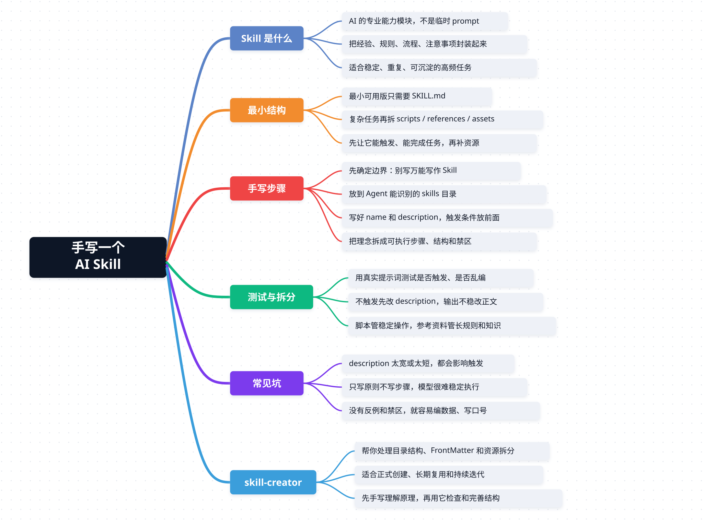

`Skill` 可以理解成 AI 的“专业能力模块”。

它不是临时 prompt，也不一定要联网调用外部工具。
更准确地说，它是一个文件夹，把某类任务里的经验、规则、操作流程和注意事项都收进去，后面反复用。

比如你经常让 AI 写周报，每次都要提醒它：

```text
不要写得太空。
不要虚构数据。
要先整理工作内容。
要写成果、问题和下周计划。
语言正式一点。
```

像这种每次都会重复提醒、又很容易沉淀成规则的东西，就适合做成 Skill。

下面我用“工作总结写作”举例，创建一个叫 `work-summary-writing` 的 Skill。

## 一个 Skill 长什么样？

一个最简单的 Skill，其实只需要一个 `SKILL.md` 文件：

```text
work-summary-writing/
└── SKILL.md
```

更完整的 Skill 还可以包含这些目录：

```text
work-summary-writing/
├── SKILL.md
├── scripts/
├── references/
└── assets/
```

不同目录的作用不一样：

| 目录 | 作用 |
|---|---|
| `SKILL.md` | 必需文件，描述 Skill 什么时候触发，以及触发后怎么做 |
| `scripts/` | 放可重复执行的脚本 |
| `references/` | 放较长的规则、规范、接口文档或业务资料 |
| `assets/` | 放模板、图片、字体、示例文件等输出素材 |

刚开始不用急着把目录搭得很完整。
先把 `SKILL.md` 写清楚，让它能触发、能稳定完成任务，第一版就够用了。

## 第 1 步：确定这个 Skill 解决什么问题

别一上来就写“万能写作 Skill”。

Skill 越泛，越容易失控。比如：

```yaml
description: "帮助用户写东西"
```

这个描述太宽。
写文章、写邮件、写代码注释、写广告文案、写产品需求文档，都可能触发它。
模型最后反而不知道该按哪套规则走。

我们这次只解决一个具体场景：

> 当用户需要写工作总结、周报、月报、季度总结、年度总结、项目复盘或阶段性汇报时，帮助用户把零散信息整理成一篇总结。
> 这篇总结要结构清晰、重点明确、表达正式自然。

边界说得越清楚，Skill 越稳定。

## 第 2 步：创建 Skill 目录

不同 AI 工具放 Skill 的位置不一样。

以 Codex 为例，个人全局 Skill 通常放在：

```text
~/.codex/skills/
```

如果我们要创建 `work-summary-writing`，目录结构就是：

```text
~/.codex/skills/work-summary-writing/
└── SKILL.md
```

可以用命令创建目录：

```bash
mkdir -p ~/.codex/skills/work-summary-writing
```

如果你使用的是 Claude Code，目录可能是：

```text
~/.claude/skills/work-summary-writing/
```

关键不是路径本身，而是要放进对应 Agent 能识别的 Skill 目录。

## 第 3 步：写 FrontMatter

`SKILL.md` 开头需要一段 YAML FrontMatter：

```yaml
---
name: work-summary-writing
description:  撰写、润色或整理中文工作总结类文档时使用，包括周报、双周报、月报、季度总结、半年/年度总结、项目复盘、阶段性汇报、述职报告、工作小结等。当用户说"帮我写个周报"、"整理一份月度工作"、"年终总结"、"项目复盘"、"做汇报材料"、"述职"，或扔过来一堆零散工作记录要求"总结一下"、"整理成报告"时，都要主动启用。该技能用于帮助用户把零散工作内容整理成结构清晰、重点明确、表达正式自然的总结文本。
---

```

这里最重要的是两个字段：

| 字段 | 作用 |
|---|---|
| `name` | Skill 的名字，建议使用小写英文、数字和连字符 |
| `description` | Skill 的触发条件和能力说明 |

很多人会低估 `description`。

它不是写给人看的简介，而是给 AI 判断“什么时候该加载这个 Skill”的依据。
只有 Skill 被触发后，AI 才会继续读正文。
触发条件如果只写在正文里，模型可能根本看不到。

所以 `description` 里至少要说清楚三件事：

- 这个 Skill 能做什么。
- 适合什么场景。
- 用户说哪些话时应该触发。

不要写成：

```yaml
description: 帮助写总结
```

这太短，也太模糊。

## 第 4 步：把流程写成可执行步骤

Skill 更像操作手册，不是理念宣言。

不要只写：

```text
写得专业、自然、有逻辑。
```

这类话方向没错，但模型不好执行。更稳的写法，是把任务拆成一步一步的动作。

下面是一个完整的 `SKILL.md` 示例：

````markdown
---
name: work-summary-writing
description:  撰写、润色或整理中文工作总结类文档时使用，包括周报、双周报、月报、季度总结、半年/年度总结、项目复盘、阶段性汇报、述职报告、工作小结等。当用户说"帮我写个周报"、"整理一份月度工作"、"年终总结"、"项目复盘"、"做汇报材料"、"述职"，或扔过来一堆零散工作记录要求"总结一下"、"整理成报告"时，都要主动启用。该技能用于帮助用户把零散工作内容整理成结构清晰、重点明确、表达正式自然的总结文本。
---

# 工作总结写作

## 写作步骤

### 1. 明确总结范围

先判断总结的时间范围、使用场景和目标字数，例如：

- 周报
- 月报
- 季度总结
- 年度总结
- 项目阶段总结
- 个人工作复盘

如果用户没有说明时间范围，可使用“本阶段”作为默认表述。

如果用户没有说明字数，默认生成 800-1200 字左右的工作总结。

### 2. 提炼核心工作

从用户提供的信息中提取主要工作内容。

优先识别：

- 负责了什么任务
- 推进了哪些项目
- 解决了哪些问题
- 参与了哪些协作
- 完成了哪些交付

### 3. 整理工作成果

将工作内容转化为结果表达。

尽量补充：

- 完成情况
- 进展状态
- 产生的价值
- 效率提升
- 问题解决效果
- 可量化数据

如果用户没有提供数据，不要编造，可使用“提升了工作效率”“推动了项目进展”等稳妥表达。

### 4. 分析问题与不足

客观总结工作中存在的问题。

可以从以下角度整理：

- 进度是否受阻
- 沟通是否充分
- 流程是否顺畅
- 方案是否还有优化空间
- 个人能力是否需要提升

表达要克制，不夸大问题，也不回避问题。

### 5. 提炼经验与反思

总结本阶段获得的经验。

重点写：

- 哪些方法有效
- 哪些流程可以复用
- 哪些协作方式值得保留
- 后续可以如何改进

### 6. 制定下一步计划

根据前文内容，提出后续计划。

计划应具体、可执行，例如：

- 继续推进某项任务
- 优化某个流程
- 提升某项能力
- 完成某个交付
- 加强沟通协作

## 字数要求

- 优先遵循用户明确提出的字数要求。
- 如果用户没有提出字数要求，默认生成 800-1200 字。
- 如果用户要求“简短”“简单”“概括”，控制在 300-600 字。
- 如果用户要求“详细”“完整”“正式”，控制在 1200-2000 字。
- 不要为了凑字数重复表达。
- 不要为了压缩字数删掉关键事实。

## 推荐结构

```text
一、总体情况
简要说明本阶段的工作重点和整体完成情况。

二、主要工作
分条说明完成的重点事项。

三、工作成果
总结取得的结果、进展或价值。

四、问题与不足
客观说明存在的问题和改进空间。

五、经验总结
提炼本阶段的收获和方法。

六、下一步计划
说明后续重点工作安排。
```

## 注意事项

- 不要虚构关键事实、数据、项目名称或成果。
- 用户提供的信息不足时，可以使用通用表达，但应避免写得过满。
- 表达要正式、自然、简洁，避免口号式语言。
- 多写具体行动和实际结果，少写空泛态度。
- 总结个人工作时，突出职责和贡献，但不要过度夸大。
- 总结团队工作时，注意使用“我们”“团队”等表述。
- 问题与不足要真实可改进，不要写成严重失误。
- 下一步计划要和前文问题、成果形成呼应。

## 输出要求

默认输出一篇完整工作总结。

如果用户只要求框架，则只输出结构和要点。

如果用户提供了原始素材，应优先基于素材改写，不随意扩展事实。
````

写到这里，一个最小可用的 Skill 就完成了。

## 第 5 步：测试 Skill 是否能触发

保存后，可以用接近真实场景的提示词测试：

```text
帮我写一份本周工作总结。
```

或者：

```text
把下面这些工作记录整理成月报，正式一点，控制在 1000 字左右。
```

测试时我一般看三件事：

1. 是否会按工作总结场景响应。
2. 是否遵守结构、字数和注意事项。
3. 是否在信息不足时乱编数据。

经常不触发，就先改 `description`。

能触发，但输出不稳定，就改正文里的“写作步骤”“注意事项”和“输出要求”。

## 第 6 步：什么时候需要 scripts、references 和 assets？

不是每个 Skill 都需要额外目录。

像“工作总结写作”这种偏写作和判断的 Skill，通常一个 `SKILL.md` 就够。

任务变复杂之后，再考虑拆资源。

### 需要 scripts 的情况

如果某个操作需要稳定执行，就别让 AI 每次重新想办法。

例如：

```text
markdown-mermaid-to-images/
├── SKILL.md
└── scripts/
    └── convert_mermaid.py
```

这类任务涉及文件扫描、图片导出、路径替换。交给脚本，比写一堆自然语言规则可靠。

### 需要 references 的情况

如果有大量规则、规范、接口文档或业务知识，就放到 `references/`。

例如：

```text
contract-review/
├── SKILL.md
└── references/
    └── clause-checklist.md
```

`SKILL.md` 只写核心流程，并说明什么时候读取参考资料。

### 需要 assets 的情况

如果最终产物需要模板或素材，就放到 `assets/`。

例如：

```text
slides-builder/
├── SKILL.md
└── assets/
    └── company-template.pptx
```

这样 AI 不用每次重新创建模板，也更容易保持统一样式。

## 手写 Skill 的常见问题

手写 Skill 很适合理解原理，但也容易踩坑。

### 1. description 太宽泛

错误示例：

```yaml
description: 写作助手
```

这个描述几乎什么都能触发，边界太宽。

更好的写法：

```yaml
description: 撰写、润色或整理中文工作总结类文档时使用，包括周报、双周报、月报、季度总结、半年/年度总结、项目复盘、阶段性汇报、述职报告、工作小结等。当用户说"帮我写个周报"、"整理一份月度工作"、"年终总结"、"项目复盘"、"做汇报材料"、"述职"，或扔过来一堆零散工作记录要求"总结一下"、"整理成报告"时，都要主动启用。该技能用于帮助用户把零散工作内容整理成结构清晰、重点明确、表达正式自然的总结文本。
```

### 2. 只写原则，不写步骤

错误示例：

```markdown
## 要求

写得专业、自然、有深度。
```

更好的写法，是把“专业”拆成动作：

- 先判断总结范围。
- 再提炼核心工作。
- 然后整理成果。
- 接着写问题与不足。
- 最后写经验和计划。

### 3. 把所有东西都塞进 SKILL.md

`SKILL.md` 最好保持精简。

内容越来越长时，通常就该拆了：

- 长规范放 `references/`。
- 重复操作放 `scripts/`。
- 模板素材放 `assets/`。

### 4. 没有写反例和禁区

很多输出问题，不是 AI 不知道该做什么，而是不知道什么不能做。

例如工作总结里必须明确：

- 不要虚构数据。
- 不要写口号。
- 不要把小问题写成严重事故。
- 不要为了凑字数重复表达。

限制写得越清楚，输出越稳定。

## 接下来：用 skill-creator 自动创建

手写过一遍之后，再看 `skill-creator` 就顺很多。

`skill-creator` 也是一个 Skill，只是它专门负责创建和更新 Skill。
目录结构、FrontMatter、资源该不该拆，它会帮你一起处理。
你不用每次都从空白文件开始。

github地址：[https://github.com/anthropics/skills/tree/main/skills/skill-creator](https://github.com/anthropics/skills/tree/main/skills/skill-creator)

安装 skill-creator：
```bash
npx skills add https://github.com/anthropics/skills --skill skill-creator
```

你可以直接这样要求 claude code:

```text
使用 skill-creator，帮我创建一个 work-summary-writing skill。

目标：
当用户需要写工作总结、周报、月报、季度总结、年度总结、项目复盘或阶段性汇报时触发。

能力：
1. 判断总结范围和字数要求。
2. 从零散工作记录中提炼核心工作。
3. 整理工作成果、问题不足、经验总结和下一步计划。
4. 输出正式、自然、结构清晰的工作总结。

注意事项：
1. 不要虚构关键事实、数据、项目名称或成果。
2. 信息不足时使用稳妥表达。
3. 避免口号式语言。
4. 下一步计划要具体可执行。

位置：
安装到全局 Claude skills 目录。
```

这种请求比“帮我创建一个写周报 Skill”稳定得多。
边界给清楚了，`skill-creator` 才知道该往哪里收、哪里不能展开。

## skill-creator 会帮你做什么？

`skill-creator` 不只是生成一个空文件夹。

它会从“另一个 AI 以后怎么用这个 Skill”的角度，帮你把这些事情过一遍：

1. 理解这个 Skill 要解决什么问题。
2. 整理触发条件和真实使用场景。
3. 规划是否需要 `scripts/`、`references/`、`assets/`。
4. 创建 Skill 目录和 `SKILL.md`。
5. 写好 `name`、`description` 和正文流程。
6. 必要时补充资源文件。
7. 检查 Skill 结构是否完整。
8. 根据真实使用结果继续迭代。

换句话说，手写时你要自己操心的细节，`skill-creator` 会替你检查一轮。

## 为什么要用 skill-creator？

手写适合学习原理。真要长期用，我更建议交给 `skill-creator` 起草和迭代。

原因主要有四个。

### 1. 它更懂 Skill 的结构

一个 Skill 不只是写一段 prompt。

它需要考虑：

- `name` 是否规范。
- `description` 是否能准确触发。
- 正文是否是可执行流程。
- 是否缺少注意事项。
- 是否应该拆分资源目录。

这些细节手写时很容易漏掉。

### 2. 它能减少触发错误

低质量 Skill 最常见的问题，就是 `description` 写得太宽，或者太窄。

太宽会误触发，太窄会不触发。

`skill-creator` 会提醒你把能力、场景和触发词写清楚。
比如别只写“处理合同”，要写成“当用户要求检查合同、总结合同风险或整理关键条款时使用”。

### 3. 它会帮你判断资源怎么拆

很多人第一次写 Skill，会把所有规则都塞进 `SKILL.md`。

短期能用，时间一长就会臃肿。

`skill-creator` 会根据任务判断：

- 是否需要脚本保证稳定执行。
- 是否需要参考资料保存长规则。
- 是否需要模板或素材支持最终输出。

这就是渐进加载：常用规则放正文，长资料按需读取，重复操作交给脚本。

### 4. 它适合持续迭代

好的 Skill 通常不是一次写完的。

真实使用后，你会发现它可能有这些问题：

- 某些提示词没有触发。
- 输出格式不稳定。
- 经常编造不存在的数据。
- 处理复杂输入时漏步骤。
- 和其他 Skill 的边界冲突。

这时可以继续让 `skill-creator` 检查和更新：

```text
使用 skill-creator 检查这个 skill 是否合格：
~/.claude/skills/work-summary-writing

重点检查：
1. description 是否能准确触发。
2. SKILL.md 是否过长。
3. 写作步骤是否可执行。
4. 注意事项是否覆盖常见错误。
5. 是否需要拆分 references 或 assets。
```

这比临时修一句 prompt 稳得多。

## 手写和 skill-creator 怎么选？

可以按这个规则判断：

| 场景 | 建议 |
|---|---|
| 第一次学习 Skill | 手写一遍 |
| 只需要一个很小的个人规则 | 手写也可以 |
| 要创建长期复用的 Skill | 用 `skill-creator` |
| Skill 涉及脚本、模板、参考资料 | 用 `skill-creator` |
| 需要检查触发条件和目录结构 | 用 `skill-creator` |
| 需要迭代已有 Skill | 用 `skill-creator` |

我的建议是：先手写一个最小版本，搞清楚 `name`、`description`、正文流程和注意事项分别在干什么。
之后要创建正式 Skill，再交给 `skill-creator`。

## 小结

写 Skill 的重点，不是把 prompt 写长。
真正要做的，是把高频任务沉淀成一套能触发、能执行、后面还能维护的工作流。

一个好 Skill，至少要回答四个问题：

1. 什么时候触发？
2. 触发后按什么步骤做？
3. 输出应该长什么样？
4. 哪些事情不能做？

手写能帮你理解底层结构。`skill-creator` 则适合把这套结构做完整，并且在后续使用中持续修。

第一版 Skill 不需要完美。
先让它在真实任务里跑起来。
哪里触发错了，就补触发条件；哪里输出跑偏了，就补规则和反例；哪里靠文字说不稳，就拆资源、加脚本。
Skill 是这样一点点变强的。



## 往期回顾
- [AI Skill 是什么？一篇讲清楚它和 Prompt、MCP 的区别](https://mp.weixin.qq.com/s/Aj7mOtgJd2xxlNJg464wow)
- [如何寻找、安装和管理 AI Skill？](https://mp.weixin.qq.com/s/lgKiloZ83TbB2iYaa-EX5g)